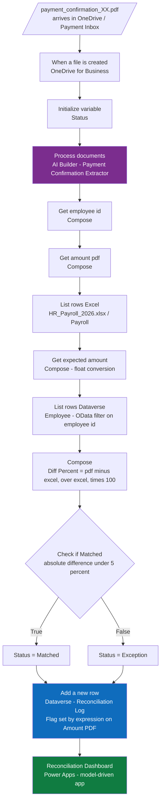
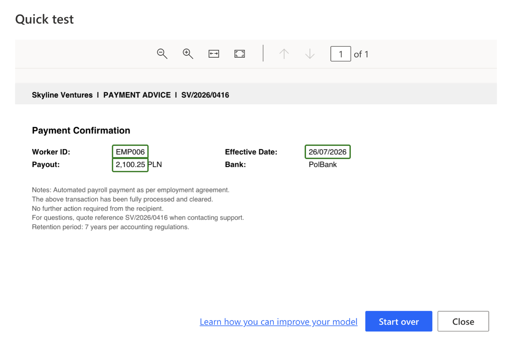
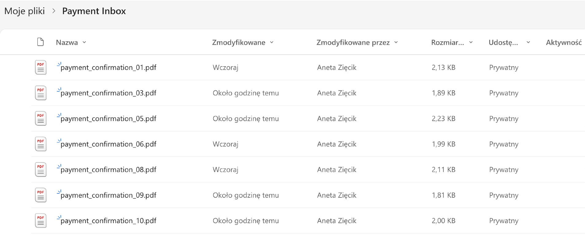
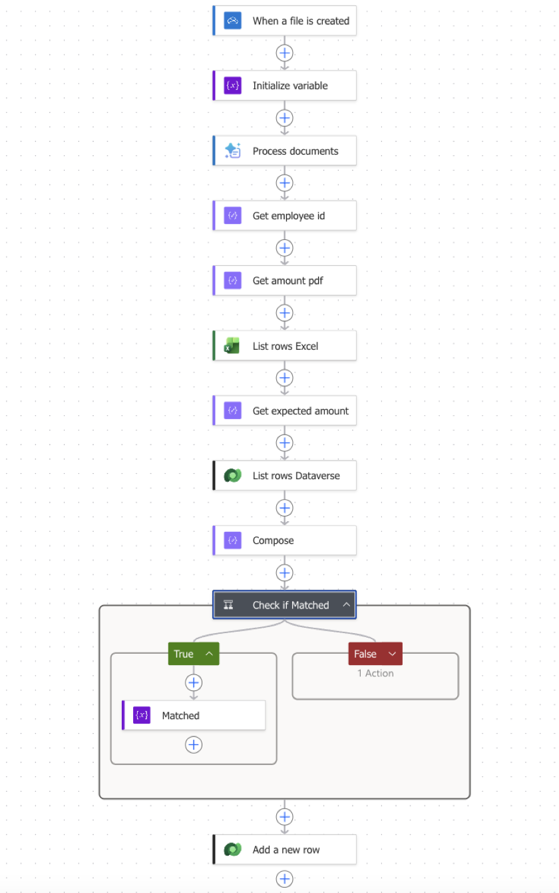
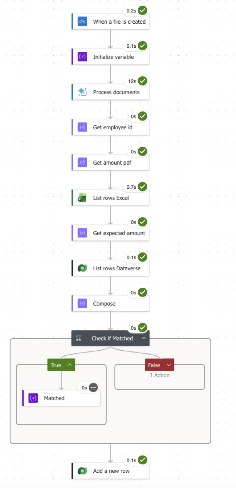
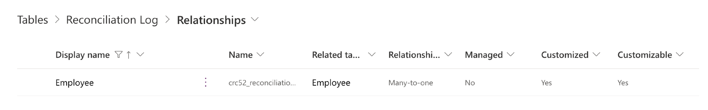
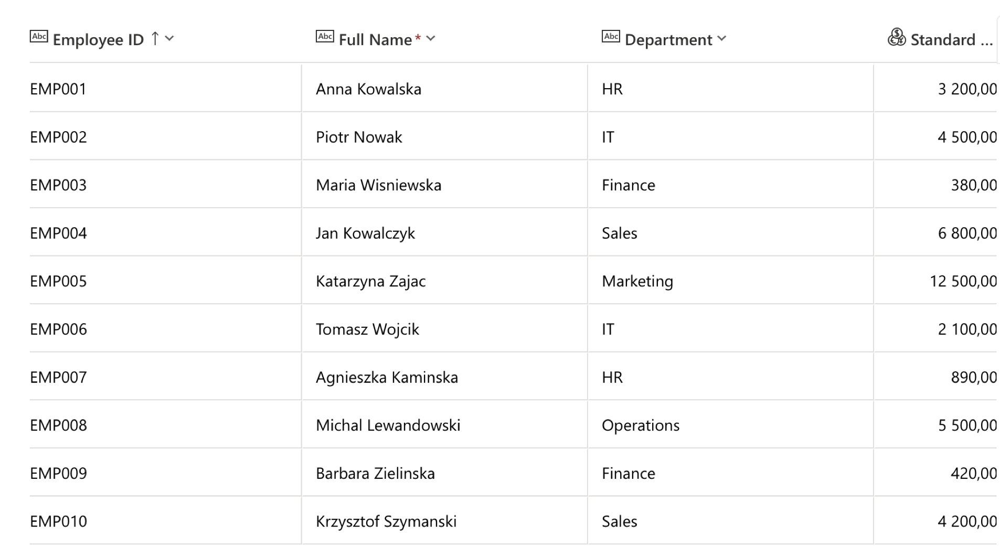
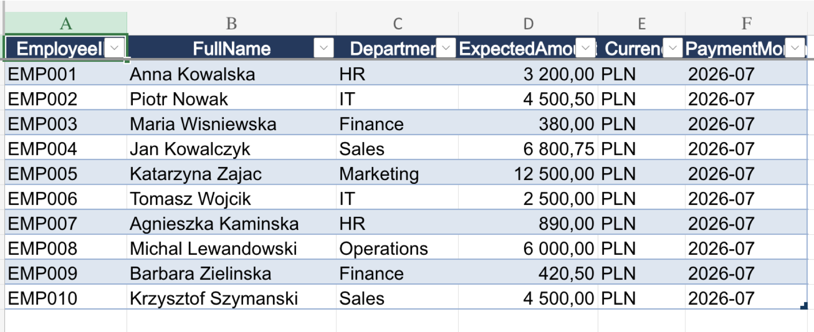
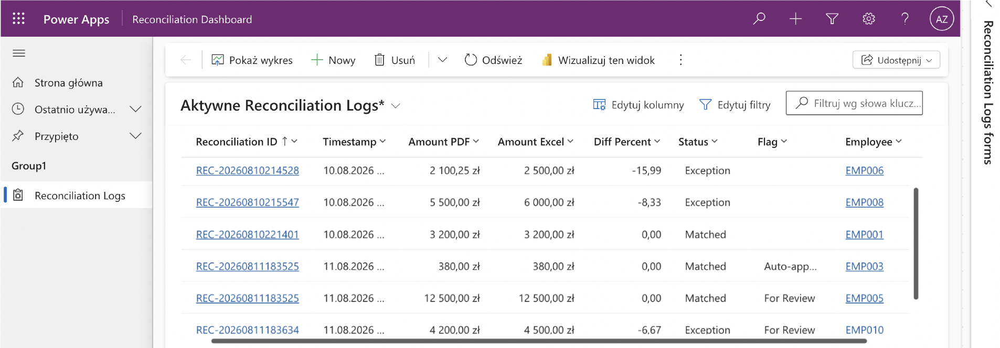

# Reconciliation Assistant V2 - PDF to Dataverse

Automated reconciliation of payment confirmations against a payroll register, built on Microsoft Power Platform.

A PDF lands in a OneDrive folder. Within seconds its contents are extracted by a custom AI model, cross-checked against the payroll spreadsheet, matched to an employee record, classified, and written to an audit log - without anyone opening the file.

**Stack:** Power Automate · AI Builder · Dataverse · Excel Online · Power Apps

---

## Data and privacy

**Every piece of data in this repository is fictional and was created for this project.**

- Employee names, IDs, departments and amounts were invented for the demonstration. None of them corresponds to a real person, and any resemblance to a real individual is coincidental.
- The payment confirmation PDFs were generated from a script, with layouts varied deliberately to test the extraction model against documents it had not seen.
- The payroll spreadsheet is a fabricated file, not an export from any system.
- The project runs in a dedicated learning tenant created for this programme. It is not connected to any employer's environment, production system, or live data source.
- No personal data, financial records, or confidential information belonging to any organisation appears in this repository, in the screenshots, or in the exported flow package.

The exported solution contains component definitions and connector references only - no credentials, tokens, or connection secrets.

---

## Problem

Back-office reconciliation of payment confirmations is manual, slow and easy to get wrong:

- Confirmations arrive as PDFs, each from a different sender, each with a different layout
- Someone opens every file, reads the employee ID and the amount, then finds the matching row in the payroll spreadsheet
- Small discrepancies get missed; large ones get caught late
- There is no audit trail beyond the spreadsheet itself - no record of *when* something was checked or *why* it was flagged

At roughly two minutes per document, a hundred confirmations is over three hours of work that leaves behind nothing anyone can query afterwards.

---

## Solution

An event-driven flow that runs on file arrival and produces a structured, queryable reconciliation log.

| Stage | What happens |
|---|---|
| **Ingest** | New PDF in the OneDrive `Payment Inbox` folder triggers the flow |
| **Extract** | Custom AI Builder model reads worker ID, amount and date regardless of layout |
| **Cross-check** | Expected amount is pulled from the payroll table in Excel |
| **Enrich** | Employee record is resolved in Dataverse and linked through a many-to-one relationship |
| **Classify** | Percentage difference computed; over 5% → `Exception`, otherwise `Matched` |
| **Flag** | Amounts above 500 → `For Review`, otherwise `Auto-approved` |
| **Log** | A row is written to the Reconciliation Log table |

Status and Flag are deliberately independent. A payment can reconcile perfectly and still need a human to look at it because of its size - two different questions about the same record.

---

## Architecture



**Why a Compose step between every extraction and its use.** AI Builder returns a nested object, and Excel returns everything as text. Referencing `body/fields/amount/value` directly inside a filter or a calculation makes the expression unreadable and impossible to debug. Each Compose pulls one primitive out, names it, and shows its own value in the run history - which turned "the flow failed somewhere" into "step 7 returned null" on every subsequent error.

**Why both Excel and Dataverse.** Excel holds the expected amounts, mirroring the file an operations team actually maintains. Dataverse holds employee master data and the reconciliation log. Keeping them separate demonstrates cross-system integration rather than a single-database exercise.

**Why the threshold logic lives in the flow rather than in a business rule.** See Lessons learned.

---

## Tech stack

| Layer | Technology |
|---|---|
| Orchestration | Power Automate - cloud flow, 11 top-level steps |
| Document AI | AI Builder - custom document processing model (General documents) |
| Database | Microsoft Dataverse - 2 tables, many-to-one relationship, business rule |
| Source data | Excel Online (Business), OneDrive for Business |
| Interface | Power Apps - model-driven app |
| Environment | Power Apps Developer Plan |

### Data model

**Employee** - 10 records, `EMP001`-`EMP010`: employee ID, full name, department, and `Standard Amount`, the employee's standing monthly figure.

`Standard Amount` and the payroll file's `ExpectedAmount` are deliberately different quantities: the first is what an employee normally receives, the second is what is due for one specific payment month. They can differ for the same person without either being wrong. The reconciliation reads expected amounts from Excel only.

**Reconciliation Log** - 10 columns

| Column | Type | Source |
|---|---|---|
| Reconciliation ID | Text | Generated in flow from UTC timestamp |
| Timestamp | Date and time | Generated in flow |
| PDF Source | Text | Trigger |
| Excel Source | Text | Static |
| Amount PDF | Currency | AI Builder |
| Amount Excel | Currency | Excel |
| Diff Percent | Decimal | Calculated |
| Status | Choice | Condition branch |
| Flag | Choice | Expression on Amount PDF |
| Employee | Lookup → Employee | Dataverse query |

---

## The AI model

A custom **document processing** model trained on synthetic payment confirmations with deliberately varied layouts - different fonts, field labels, date formats and page structures, including a Courier-style memo and an ASCII teletype format as stress tests.

| | |
|---|---|
| Fields extracted | Worker ID (text), payout amount (number), effective date (date) |
| Training set | 5 documents |
| Test set | 5 held-out documents, unseen layouts |
| Accuracy | **15 / 15 fields (100%)** |

Prebuilt models were considered first. The prebuilt invoice model expects invoice semantics - vendor, line items, tax - which do not map onto a payroll confirmation. A custom model trained on the actual document shapes was the correct choice, and the layout variety in the training set is what makes it generalise to documents it has never seen.

---

## Results

Seven confirmations processed end to end: **3 Exceptions, 4 Matched.**

| Source PDF | Employee | Amount PDF | Amount Excel | Diff | Status | Flag |
|---|---|---|---|---|---|---|
| payment_confirmation_06.pdf | EMP006 | 2 100,25 | 2 500,00 | -15,99% | Exception | - |
| payment_confirmation_08.pdf | EMP008 | 5 500,00 | 6 000,00 | -8,33% | Exception | - |
| payment_confirmation_01.pdf | EMP001 | 3 200,00 | 3 200,00 | 0,00% | Matched | - |
| payment_confirmation_03.pdf | EMP003 | 380,00 | 380,00 | 0,00% | Matched | Auto-approved |
| payment_confirmation_05.pdf | EMP005 | 12 500,00 | 12 500,00 | 0,00% | Matched | For Review |
| payment_confirmation_10.pdf | EMP010 | 4 200,00 | 4 500,00 | -6,67% | Exception | For Review |
| payment_confirmation_09.pdf | EMP009 | 420,50 | 420,50 | 0,00% | Matched | Auto-approved |

Amounts in PLN.

Two rows are worth reading together. `EMP003` and `EMP005` both reconcile exactly - zero difference, both `Matched` - but only the 12 500 payment carries `For Review`. Size and correctness are separate concerns, and the log records both.

The first three rows have an empty Flag because they were written before the threshold expression was added. The gap is visible in the log rather than backfilled - it shows when the rule came into force.

---

## Screenshots

### Document extraction



AI Builder Quick test on a document the model was never trained on. Worker ID, payout and effective date located and read correctly despite a layout the model had not seen.

### Trigger folder



The watched OneDrive folder. Dropping a file here is the only manual action in the process.

### The flow



All eleven steps, from trigger to Dataverse write.



A successful run. Document processing takes about 12 seconds; every other step completes in under a second.

### Data layer



Many-to-one relationship from Reconciliation Log to Employee. This is what lets the log show an employee instead of an ID.



Employee master data in Dataverse.



The payroll register in Excel - the source of expected amounts.

### Interface



The model-driven app. Amount from the PDF, expected amount, percentage difference, classification, flag and linked employee - one row per reconciliation.

---

## Lessons learned

Nine distinct failures were debugged during the build. The ones worth writing down:

**`abs()` does not exist in Power Automate.** Workflow Definition Language has no absolute-value function. Implemented as `max(x, mul(x, -1))`.

**The Excel connector returns numbers as strings.** Arithmetic on them fails silently or produces nonsense. Every value coming from Excel needs `float()` before use.

**AI Builder output paths must come from the dynamic content picker.** Hand-writing `body/predictionOutput/fields/amount/value` looks right and returns nothing - the real path is `body/fields/amount/value`. Picking the field from the UI resolves it correctly every time.

**Choice columns need integers, not labels.** Writing `"Exception"` to a Choice column fails; the connector expects the underlying option value.

**Dataverse Lookup columns need OData binding.** A raw GUID is rejected. The format is `/tablename(guid)` - the column expects a reference to a record, not an identifier.

**The Dataverse classic designer mangles decimals under a Polish locale.** A business rule condition entered as `500` saved as `50000`; the comma decimal separator is misparsed on save, so the rule never fired. The rule remains in the table as an artefact, but the threshold logic was moved into the flow:

```
if(greater(outputs('Get_amount_pdf'), 500), 1, 2)
```

Logic that cannot be trusted to save correctly does not belong in the database layer.

**Power Fx uses semicolons as argument separators under a Polish locale.** `SortByColumns(source, "col", SortOrder.Descending)` throws an error; the same formula with semicolons works. Every code sample online uses commas, which makes this a genuinely confusing failure.

**Timestamp-based identifiers are not unique.** Two runs within the same second produced the same `Reconciliation ID` - visible in the log as a duplicate `REC-20260811183525`. Dataverse keeps its own GUID as the primary key so nothing breaks, but a repeated identifier in an audit log is a design flaw. Fix: append a short random suffix with `substring(guid(), 0, 4)`.

**`utcNow()` and the displayed timestamp disagree by the timezone offset.** The ID encodes UTC while the Timestamp column renders in local time, so `REC-20260811183525` carries a Timestamp of 20:35. Harmless here, confusing to anyone correlating the two. Either generate both from the same converted value, or state the convention in the schema.

**Debug in small steps.** Extracting primitives into named Compose actions before using them is what made every subsequent error diagnosable.

---

## Future enhancements

- Handle payroll rows with no matching confirmation, and confirmations with no matching payroll row
- Teams notification summarising each run: documents processed, exceptions found
- Batch mode for a folder of documents rather than one file at a time
- Retry and error handling for malformed or unreadable PDFs
- Canvas app with status colour-coding and summary tiles

---

## Repository contents

```
reconciliation-assistant/
├── README.md
├── solution/
│   └── ReconciliationAssistant_1_0_0_0.zip       unmanaged solution: cloud flow, both
│                                                 Dataverse tables, AI Builder model
├── data/
│   ├── HR_Payroll_2026.xlsx                     synthetic payroll register
│   └── sample_pdfs/                             synthetic payment confirmations
└── screenshots/
```

---

*Built as part of a structured Power Platform upskilling programme - week 7 of 12.*

