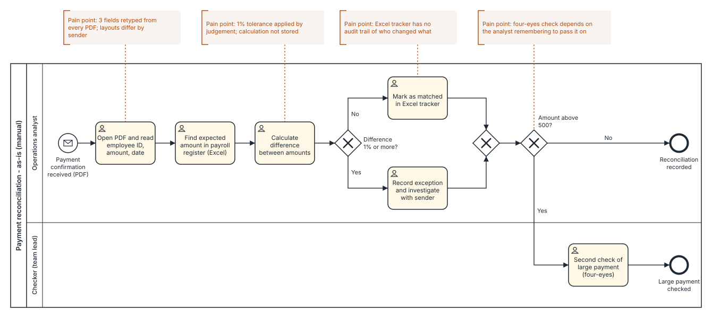
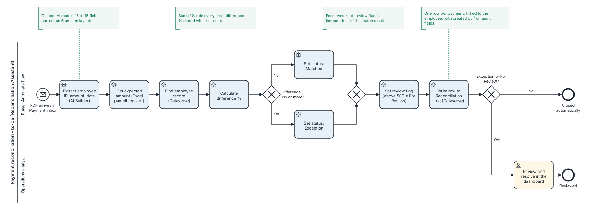

# Reconciliation Assistant - Business Analysis Case Study

**Author:** Aneta Zięcik · **Date:** November 2026 · **Project:** [Reconciliation Assistant](../README.md) (Power Automate, AI Builder, Dataverse)

This case study documents the analysis behind my Reconciliation Assistant: the current manual process, the target process, the business rules, user stories with acceptance criteria, a business case and the test results. It shows how I work as an analyst: understand the problem, design the solution with the people who build it, and test it before go-live.

> All data in this project is synthetic. Volumes and costs in the business case are illustrative assumptions, shown to explain the method.

---

## 1. Problem and objective

Back-office teams receive payment confirmations as PDF files from different senders, each in its own layout. Before a payment is accepted, someone has to check it against the expected amount in the payroll register. Done by hand, every confirmation means opening a file, retyping three values, looking up the employee, calculating the difference and writing the result into an Excel tracker.

**Objective:** automate the routine matching, keep people focused on exceptions and large payments, and keep a complete audit trail of every decision.

| In scope (MVP) | Out of scope (backlog) |
|---|---|
| PDF confirmations arriving in one shared folder | Alerts in Teams or email |
| Reading employee ID, amount and payment date | Handling unreadable documents (status Failed) |
| Comparison with the payroll register | Duplicate payment detection |
| Match status, review flag and a log record | Integration with core banking or payroll systems |
| Dashboard for reviewing results | |

## 2. Stakeholders

| Stakeholder | What they need |
|---|---|
| Operations analyst | Less retyping, a clear list of items that need attention |
| Team lead / checker | Four-eyes check on large payments, simple KPIs |
| Payroll / HR (data owner) | Expected amounts taken from their register, not copied by hand |
| Audit and compliance | A trace of who decided what and when |
| IT / Power Platform admin | Supported licences, a secure environment, documented solution |

## 3. As-is process

**Pain points**

1. **Manual data entry.** Three values are retyped from every PDF, and the layout differs by sender, so it is slow and error-prone.
2. **Inconsistent rule.** The 1% tolerance is applied by judgement and the calculation is not stored, so the decision cannot be checked later.
3. **No audit trail.** The Excel tracker does not show who changed a row or when.
4. **Fragile control.** The second check of large payments depends on the analyst remembering to pass the item on.

## 4. To-be process

**What changes**

- The flow starts by itself when a PDF lands in the Payment Inbox folder.
- A custom AI Builder model reads employee ID, amount and payment date from any layout.
- The expected amount comes straight from the payroll register, and the employee record from Dataverse.
- The same 1% rule is applied every time, and the difference is stored with the record.
- Large payments are still flagged for a human check, independently of the match result.
- People only look at items that need a decision. Everything else closes automatically and stays in the log.

## 5. Business rules

| ID | Rule |
|---|---|
| BR1 | Difference % = (amount on PDF - expected amount) / expected amount × 100, stored on the record |
| BR2 | If the absolute difference is 1% or more, status = **Exception**; if it is below 1%, status = **Matched**. Shortfalls and overpayments are treated the same |
| BR3 | If the amount on the PDF is above 500, flag = **For Review**; otherwise flag = **Auto-approved**. The flag does not depend on the status |
| BR4 | The expected amount is the amount due for the payment month in the payroll register. The Standard Amount on the employee record is reference data and is not used for matching |
| BR5 | One log record per processed confirmation, linked to the employee record |

## 6. User stories and acceptance criteria

**US1 - Automatic start** (Done)

*As an operations analyst, I want reconciliation to start as soon as a confirmation lands in the Payment Inbox folder, so that I don't have to open and track each file.*
- Given a new PDF is saved in the Payment Inbox folder, when the file is created, then the flow processes that file.
- Given the flow has finished, then the source file name is stored in the log record.

**US2 - Read the confirmation** (Done)

*As an operations analyst, I want employee ID, amount and payment date read from the confirmation in any layout, so that I don't retype data.*
- Given a confirmation in a layout the model has not seen, when it is processed, then all three fields are extracted correctly.
- Verified on 5 unseen layouts: 15 of 15 fields correct.

**US3 - Expected amount** (Done)

*As an operations analyst, I want the expected amount taken from the payroll register for the same employee, so that every payment is compared with the agreed source.*
- Given employee ID EMP006 on the PDF, then the flow reads the expected amount from the EMP006 row of the payroll register.
- Amounts stored as text in Excel are converted to numbers before the comparison.

**US4 - Tolerance rule** (Done)

*As a team lead, I want payments that differ from the expected amount by less than 1% marked Matched and the rest marked Exception, so that the team only works on real discrepancies.*
- Given a difference of -6.67% (EMP010), then status = Exception.
- Given a difference of 0.00% (EMP001), then status = Matched.
- Given a difference of exactly 1%, then status = Exception (boundary of BR2).
- The difference % is stored on every record.

**US5 - Four-eyes flag** (Done)

*As a controls owner, I want every payment above 500 flagged For Review regardless of the match result, so that large payments always get a human check.*
- Given a matched payment above 500 (EMP005), then status = Matched and flag = For Review.
- Given a payment of 500 or less, then flag = Auto-approved.

**US6 - Audit log** (Done)

*As an auditor, I want one record per confirmation with amounts, difference, status, flag, timestamp and a link to the employee, so that I can trace every decision.*
- Given a processed PDF, then exactly one record is added to the Reconciliation Log.
- The Employee field links to the employee record, and created by / created on are filled automatically.

**US7 - Work queue** (Done)

*As an operations analyst, I want a dashboard listing the results with status and flag, so that I can work on exceptions and flagged items first.*
- The view shows Reconciliation ID, Timestamp, Employee, Amount PDF, Amount Excel, Diff %, Status and Flag without horizontal scrolling.
- The list can be filtered by Status = Exception.

**US8 - Exception alert** (Backlog)

*As an operations analyst, I want a Teams message when an Exception or For Review record is created, so that urgent items are handled the same day.*
- Given a new record with status Exception or flag For Review, then a Teams message with the employee, both amounts and a link to the record is posted within 5 minutes.

**US9 - Unreadable documents** (Backlog)

*As an operations analyst, I want documents that cannot be processed logged as Failed, so that nothing disappears without a trace.*
- Given a missing field, or an employee ID not found in the payroll register, then status = Failed and the file name is logged.

## 7. Business case

**Options considered**

| Option | Pros | Cons |
|---|---|---|
| A. Keep the manual process | No cost | Slow, error-prone, no audit trail |
| B. Excel macro (VBA) | Cheap, familiar | Cannot read PDFs in different layouts, still needs manual entry, no audit trail |
| **C. Power Platform (chosen)** | Reads PDFs with AI, consistent rules, Dataverse audit log, fits Microsoft 365 | Premium licence and AI Builder capacity needed |

**Assumptions (illustrative)**

| Item | Value |
|---|---|
| Confirmations per month | 400 |
| Manual handling time | 4 minutes per confirmation |
| Items still needing a person after automation | 25% (exceptions and payments above 500) |
| Review time per item | 3 minutes |
| Monitoring and maintenance | 2 hours per month |
| Fully loaded cost of an analyst hour | PLN 120 |
| Build effort (one-off) | 5 days (40 hours) |
| Licences | Power Automate Premium, list price USD 15 per user per month; 2 users (owner and backup) = USD 360 per year |

**Calculation**

| | Manual | Automated |
|---|---|---|
| Hours per month | 400 × 4 min = **26.7 h** | 100 × 3 min + 2 h = **7 h** |
| Hours saved per month | | **19.7 h** (about 236 h per year) |
| Value of time saved per year | | about **PLN 28,300** |
| Payback of the build effort | | about **2 months** (40 h / 19.7 h) |

**Benefits that are not in the numbers:** fewer keying errors, the same rule applied every time, a full audit trail, the four-eyes control built into the process, and capacity to absorb volume peaks without overtime.

**Risks and mitigations**

| Risk | Mitigation |
|---|---|
| The model misreads a new document layout | Retrain with new samples; large payments still reviewed; unreadable files logged as Failed (US9) |
| Number format issues (decimal separator) | Thresholds kept in the flow; boundary test cases around 1% and 500 |
| Real personal data in production | DPIA before go-live, least-privilege access, retention rules; this portfolio uses synthetic data only |
| Dependency on one person | Exported solution, documented flow and data model, a named backup owner |
| Licence or AI Builder capacity | Confirm Premium licences and AI Builder capacity with IT before the build |

**KPIs to track after go-live:** share of confirmations closed automatically, average handling time per confirmation, number of exceptions caught, extraction accuracy on new layouts, time from receipt to logged result.

## 8. Testing (UAT)

**AI extraction test:** the model was trained on 5 synthetic confirmations and tested on 5 held-out ones with different layouts (including a typewriter-style memo and a teletype-style printout). Result: **15 of 15 fields** extracted correctly.

**End-to-end test:** 7 confirmations processed, 3 exceptions caught, 4 matched.

| Employee | Amount on PDF | Expected (payroll) | Difference | Status | Flag | What the test proves |
|---|---|---|---|---|---|---|
| EMP006 | 2,100.25 | 2,500.00 | -15.99% | Exception | -* | A large shortfall is caught |
| EMP008 | 5,500.00 | 6,000.00 | -8.33% | Exception | -* | A medium shortfall is caught |
| EMP010 | 4,200.00 | 4,500.00 | -6.67% | Exception | For Review | A shortfall is caught; the flag works independently of the status |
| EMP005 | 12,500.00 | 12,500.00 | 0.00% | Matched | For Review | A matched but large payment still goes to a person |
| EMP003 | 380.00 | 380.00 | 0.00% | Matched | Auto-approved | A routine payment closes automatically |
| EMP009 | 420.50 | 420.50 | 0.00% | Matched | Auto-approved | A routine payment closes automatically |
| EMP001 | 3,200.00 | 3,200.00 | 0.00% | Matched | -* | A matched payment is logged |

Amounts in PLN. \*The first three test rows (EMP006, EMP008, EMP001) were logged before the flag expression was added to the flow, so their Flag is empty. They were deliberately not backfilled, so the log shows when the rule came into force. Processed today, all three would be flagged For Review, because their amounts are above 500.

**Defects found during testing and how they were fixed**

| # | Defect | Root cause | Fix |
|---|---|---|---|
| D1 | The review threshold was saved as 50,000 instead of 500 | The Dataverse business rule designer misread the Polish decimal separator | Threshold moved into the flow expression; rule kept as a documented example |
| D2 | The calculation failed on Excel amounts | The Excel connector returns numbers as text | Converted with float() before the calculation |
| D3 | Negative differences (shortfalls) were not handled like overpayments | Power Automate has no abs() function | Absolute value calculated as max(x, -x) |
| D4 | Status was not saved | A Choice column expects the option number, not the text | Mapped Matched / Exception to option values |
| D5 | The employee link failed | A Lookup needs a record reference, not the employee ID | Added a Dataverse step that finds the record and passes its reference |
| D6 | Filtering by employee ID did not work | The dynamic value inside the filter was passed as an object, not as text | Built the filter text with concat() |

An earlier version of the project (V1, Excel against Excel) found all 5 seeded discrepancies in its test data. V2 added PDF reading, Dataverse and the dashboard.

## 9. Next steps

1. Alerts for exceptions and flagged items (US8).
2. Failed status for unreadable documents and unknown employees (US9).
3. Duplicate detection: the same employee and payment date processed twice.
4. A Power BI report on the KPIs above.

---

## Files

| File | What it is |
|---|---|
| `diagrams/reconciliation_as-is.bpmn` | As-is process in BPMN 2.0 - open and edit at [demo.bpmn.io](https://demo.bpmn.io) |
| `diagrams/reconciliation_to-be.bpmn` | To-be process in BPMN 2.0 |
| `diagrams/*.svg`, `diagrams/*.png` | The same diagrams as images |
| `Reconciliation_Assistant_BA_Case_Study.pdf` | This case study as a PDF |
